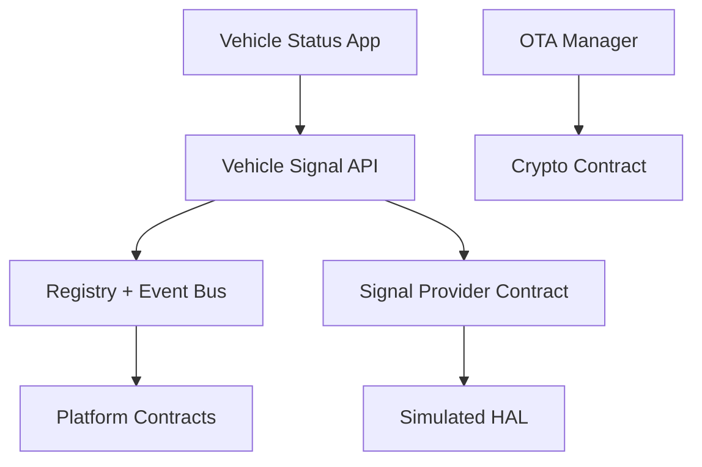
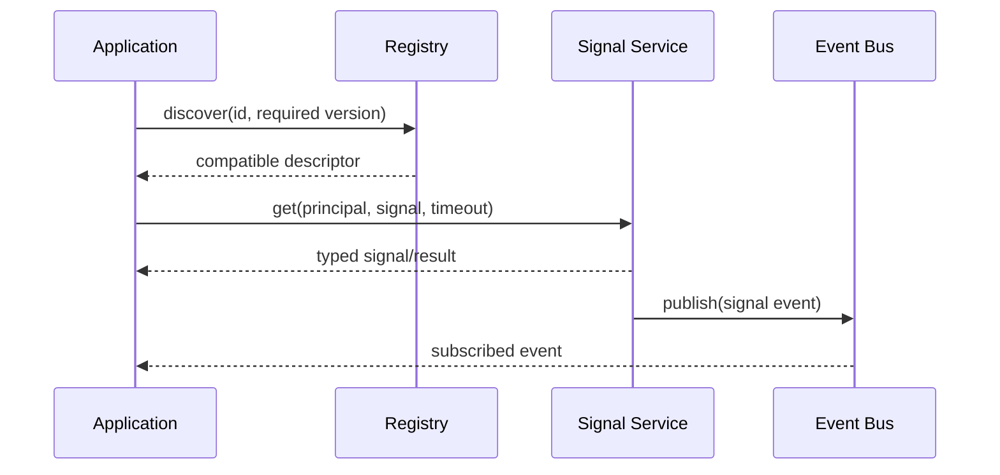

# Architecture

| Layer | Current responsibility | Dependency direction |
|---|---|---|
| L7 Applications | Vehicle Status example | service contracts only |
| L6 Services | Signals, health semantics, authorization | middleware/platform contracts |
| L5 Middleware | registry, discovery, request/event routing | platform contracts |
| L4 Platform | config, crypto/auth/time/log abstractions | OS adaptation contracts |
| L3 HAL | signal provider and CAN boundary | platform contracts |
| L2 Base software | host startup/config validation | host OS |
| L1 Implementations | Linux/x86-64 host simulator | standard C++ runtime |

No upward dependencies are permitted. `tools/dependency_checker/check.py` rejects application-to-HAL/vendor and service-to-HAL/vendor includes.

The host is buildable on Linux/x86-64. Embedded Linux, ARM64, RTOS, AUTOSAR Classic/Adaptive, SOME/IP, and DDS are porting/integration targets only. Architectural adapters do not establish AUTOSAR compliance or certification.
