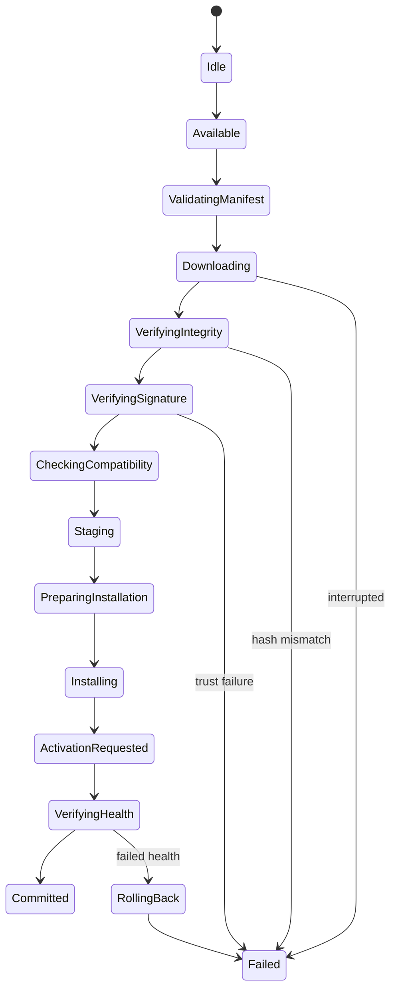

# OTA update manager

Every transition is audited. Test crypto recognizes only isolated `test-hash:`/`test-signature:` fixtures and is not production cryptography. Authenticated transport, persistent resume, bootloader activation, real A/B slots, secure elements, and power-loss-safe storage are adapter responsibilities not implemented by the host simulator.
